<div align="center">



<a href="https://github.com/JesusDMT">
  
</a>

<br/>

<a href="https://jesusdmt.github.io"></a>
<a href="mailto:entreviskaia@gmail.com"></a>

</div>

---

### 👨‍💻 Sobre mí

```csharp
public class JesusDMT
{
    public string Rol        => "Full Stack Developer";
    public string Ubicacion  => "Colombia 🇨🇴";
    public string Fuerte     => "C# · ASP.NET Core · APIs REST";
    public string[] Datos    => new[] { "MongoDB", "SQL" };
    public string[] Frontend => new[] { "JavaScript", "TypeScript", "HTML", "CSS" };
    public string[] Extra    => new[] { "Python", "n8n", "Integraciones con IA" };
    public string Mision     => "Construir software limpio que automatice y escale negocios reales.";
}
```

- 🔭 Construyo **aplicaciones web completas**: backend robusto en **ASP.NET Core** y frontends modernos.
- ⚡ Automatizo procesos con **n8n**, APIs y **agentes de IA** para ahorrar horas de trabajo manual.
- 🌱 Siempre aprendiendo: arquitectura limpia, cloud y buenas prácticas.
- 💬 Hablemos de: **.NET, APIs, automatización e IA aplicada**.

---

### 🛠️ Tech Stack

<div align="center">

**Mi fuerte**


**Frontend · Backend · Herramientas**


</div>

---

### 🚀 Proyectos destacados

| Proyecto | Descripción | Stack |
|---|---|---|
| [**Inventario**](https://github.com/JesusDMT/Inventario) | Sistema de gestión de inventario con pruebas unitarias |  |
| [**n8n-Prueba**](https://github.com/JesusDMT/n8n-Prueba) | Flujos de automatización e integraciones con IA |   |
| [**Eco_Mas_Repo**](https://github.com/JesusDMT/Eco_Mas_Repo) | Proyecto de software en C++ |  |
| [**Portafolio**](https://github.com/JesusDMT/JesusDMT.github.io) | Mi sitio web personal |  |

---

<div align="center">

### 🤝 ¿Trabajamos juntos?

Estoy abierto a **proyectos freelance, colaboraciones y oportunidades full stack**.
<br/>Escríbeme a **entreviskaia@gmail.com**


</div>
